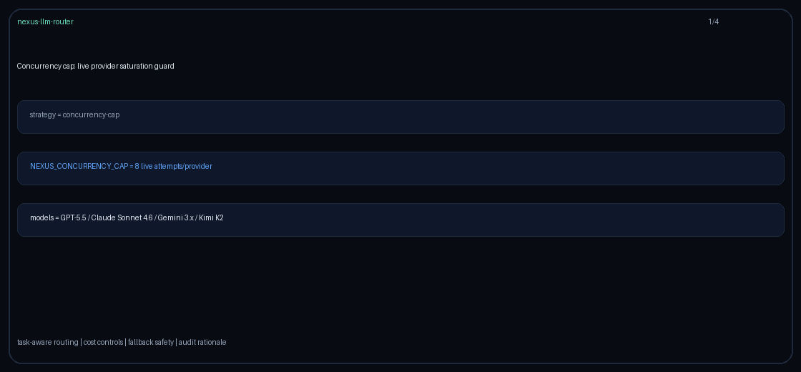

# webhook-prefer Guide

Capability-aware routing for GPT-6 Astra / Claude Opus 5.5 / Gemini 4 Argon / Kimi K3.1 Pro.

## Why

OpenAI / Anthropic async webhook callbacks and Gemini long-running job notifications.

## Signals

Metadata keys: `requires_webhook`, `webhook_callbacks`, `async_webhook`; allowlist `webhook_models`.

## Capability

Built-in map includes `webhook` on frontier models where applicable. Override with `metadata.model_capabilities` or `webhook_models`.

## Behavior

When the signal is truthy, rank healthy domain-eligible candidates by `webhook` support, then quality, then cost. Without a signal, stay quality-first.
